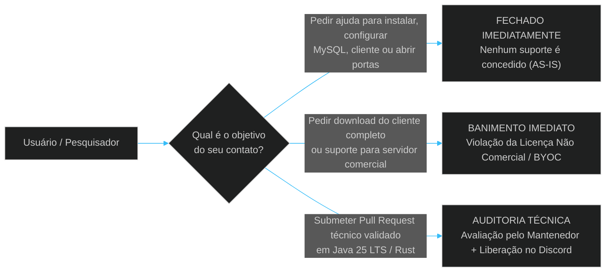

# Política de Suporte e Escopo do Projeto — AION CLASSIC 5.0 EMULADOR

  
  

  
  
  
  

> [!CAUTION]
> **DECLARAÇÃO OFICIAL: NENHUM SUPORTE OU AJUDA TÉCNICA SERÁ CONCEDIDA**  
> O **Aion Classic 5.0 — Emulador Oficial** é disponibilizado estritamente **"COMO É" (*AS-IS*)**, exclusivamente para **testes, preservação histórica e estudos técnicos de engenharia de software e sistemas distribuídos**.  
> **Este repositório NÃO é um produto comercial e NÃO oferece suporte técnico de nenhuma natureza.**

---

## 1. Fluxo de Triagem de Solicitações no Repositório

---

## 2. O Que NÃO Recebe Suporte (Sem Exceções)

Não abra *Issues*, *Pull Requests* ou mensagens solicitando ajuda sobre:
1. **Instalação e Configuração de Banco de Dados ou Ambiente:** Dúvidas sobre como instalar ou configurar MySQL 8.x / MariaDB, como editar `Config/config.json` / `database.properties`, ou como inicializar o supervisor `Aion Classic - EMULADOR.exe`.
2. **Obtenção ou Configuração do Cliente de Jogo:** Não fornecemos download do cliente completo do Aion Classic 5.0 nem prestamos suporte para aplicar o patch (`Patch final - Client 5.0`) ou solucionar erros de sistema operacional/drivers.
3. **Configuração de Rede, Firewall ou Hospedagem:** Problemas com redirecionamento de portas (`2106`, `7777`, `10241`), regras do `geo_firewall.properties` ou configuração de máquinas virtuais.
4. **Pedidos de Novos Recursos ou Prazo de Atualizações (*Roadmap*):** O projeto não possui SLA nem compromisso de atendimento a demandas externas.

---

## 3. Documentação de Autoatendimento para Pesquisadores

Toda a arquitetura, estrutura de diretórios, protocolo de rede e procedimentos de compilação estão integralmente documentados para leitura autônoma:

| Tema de Estudo | Documento de Referência |
| :--- | :---: |
| **Visão Geral, Arquitetura, Portas, Compilação e Inicialização** | [`README.md`](./README.md) |
| **Diretrizes Mandatórias de Engenharia, Opcodes 5.0 e CryEngine Native-Path** | [`CONTEXT.md`](./CONTEXT.md) |
| **Regras Explícitas de Contribuição e Padrão de Pull Request / Commits** | [`CONTRIBUTING.md`](./CONTRIBUTING.md) |
| **Política de Segurança, Firewall GeoIP e Isolamento do Supervisor** | [`SECURITY.md`](./SECURITY.md) |
| **Código de Conduta da Comunidade Técnica** | [`CODE_OF_CONDUCT.md`](./CODE_OF_CONDUCT.md) |
| **Termos de Licença Educacional e Não Comercial** | [`LICENSE`](./LICENSE) |

---

## 4. Comunidade no Discord e Regra de Desbloqueio

> [!IMPORTANT]
> O servidor oficial no Discord (**[https://discord.gg/Sjdrsg3gcb](https://discord.gg/Sjdrsg3gcb)**) **não é um canal de suporte**. Todos os canais de bate-papo permanecem bloqueados em modo somente leitura até que o colaborador tenha pelo menos **um Pull Request técnico real aprovado (*merged*)** neste repositório contendo `Discord-User: @seu_usuario`.
